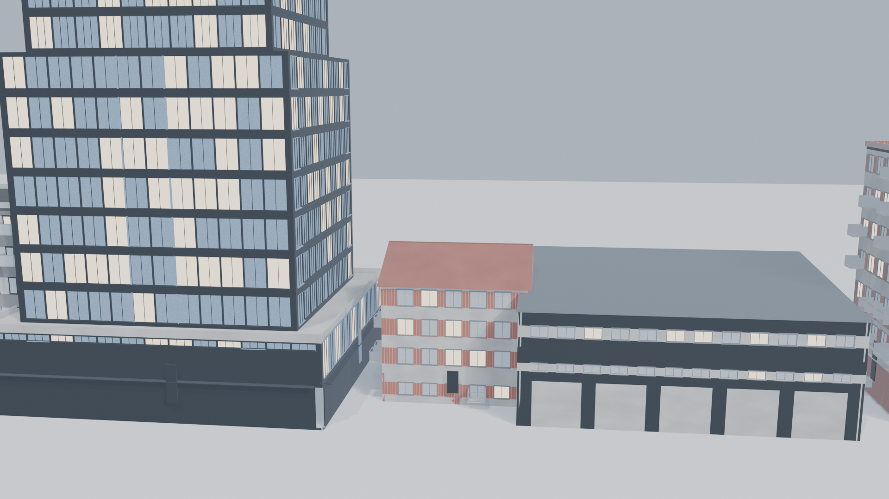

# CityForge

**CityForge** is a Blender add-on for procedurally generating game-ready city
assets — buildings, skyscrapers, roads, parks, vegetation, street furniture,
vehicles and NPC characters — with deterministic seeds, architectural level
controls, LOD support and a Unity-oriented FBX/GLB export pipeline.

Target: Blender **4.5 LTS / 5.x** (tested on 5.2.2), runs fully offline.
No paid services, no external dependencies.



---

## Feature highlights

* **10 + 5 architectural styles** — residential, commercial, office, concrete,
  brick, industrial, mixed-use, suburban, traditional and high-rise, plus five
  modern skyscraper styles (glass curtain tower, office skyscraper,
  residential tower, mixed-use tower, futuristic tower) with tower forms
  (box / tapered / setback / tapered-setback / crown), facade grids and
  crown lighting.
* **Building diversity forms** — detached house, townhouse (per-unit
  entrances), low/mid-rise apartments, high-rise towers; commercial forms
  (small retail, restaurant, cafe, pub, office, shopping, mixed-use) with
  category-specific storefronts, awnings, signs and auto-generated business
  names rendered as real 3D text.
* **Architectural levels** — three independent checkboxes: Level 1 structure,
  Level 2 facade detail, Level 3 premium detail (roof equipment, awnings,
  crown lighting). Incompatible combinations are auto-corrected.
* **Road classification** — highway / single-lane / two-lane / four-lane /
  one-way with medians (painted / raised / planted), highway barriers,
  bike + parking lanes, lane width, one-way arrow markings, crosswalks.
* **Parks** — 11 park types (neighbourhood, community, city, plaza,
  botanical, waterfront, dog, playground, sports, formal garden, forest)
  with path networks from entrances to destinations, ponds, flower beds,
  sports courts, playgrounds and vegetation/furniture as grouped children.
* **NPC characters** — low-poly people with clothing styles (casual,
  business, construction, pedestrian), builds, hair colours and optional
  accessories.
* **Vehicles** — sedan, hatchback, SUV, pickup, van, delivery truck, bus,
  taxi, sports car with body/roof/wheel colours, window tint, size scale
  and seeded random looks.
* **Colour system** — per-building primary/secondary/window/trim colours,
  or a seeded coherent random palette.
* **Deterministic seeds everywhere** — same seed + same settings = identical
  result, for every asset type.

## Installation

1. Download/locate `cityforge.zip` (the release package, or see
   *Building the ZIP* below).
2. In Blender: **Edit → Preferences → Get Extensions → ▾ (top-right) →
   Install from Disk…** and pick `cityforge.zip`.
   *(Legacy route on 4.2–4.5: Preferences → Add-ons → Install from Disk works
   too — the package carries both a `blender_manifest.toml` and a
   `bl_info` header.)*
3. Enable **CityForge** if it is not enabled automatically.
4. Open any 3D viewport and press **N** — the **CITYFORGE** tab is now in
   the sidebar.

Building the ZIP from this repository:

```bash
cd CityForge
zip -r cityforge.zip cityforge -x "*__pycache__*" -x "*.pyc"
```

## Quick start: your first building

1. Open the CITYFORGE tab.
2. Leave *Asset Type* on **Residential Building**.
3. Pick an **Architectural Style** (e.g. *Modern Residential*) — style
   defaults for windows, roof, balconies and materials load automatically.
4. Set *Seed* to any integer; the same seed always rebuilds the same asset.
5. Press **Generate**. The building appears at the world origin, organised
   under the `CityForge_Assets/Buildings/Residential` collection.
6. Press **Generate x5** / **Random Variations** for alternatives, or change
   the seed and generate again.
7. Select the asset and press **Export Selected** to write an FBX/GLB into
   `CityForge_Export/` next to your .blend.

## Interface overview

| Section | Purpose |
|---|---|
| Dashboard | Version, number of generated assets, total polygon count, category breakdown |
| Description | Optional natural-language prompt (local keyword parser, optional GLM bridge) |
| Asset Generator | Asset type, seed, detail level (LOW/MEDIUM/HIGH), variation count |
| Building Settings | Massing, facade windows, balconies, roof, ground floor, materials |
| Generation | Generate, ×5, ×10, variations, randomise settings, regenerate, delete |
| Optimization | LOD creation, cleanup (with optional originals preserved), material re-apply/purge |
| Export | Directory, FBX/GLB, selected asset or batch export |

Every generated object carries custom properties (`cityforge_seed`,
`cityforge_params`, `cityforge_polygons`, `cityforge_generated_at`, …) so it
can be **regenerated** later with *Regenerate Selected*.

## Natural-language prompts

Type a description such as:

> "Generate a modern 12-storey residential apartment building with a concrete
> podium, glass balconies, dark grey window frames, a flat roof, rooftop HVAC
> equipment, and a small ground-floor retail section."

and press **Apply Description**. Two engines are available:

* **Local parser** (always available, no network): deterministic keyword and
  number extraction. It understands storey counts, dimensions, styles, roofs,
  ground-floor use, balcony types and seeds. Limited but honest.
* **GLM bridge** (optional): enable the *Use GLM Bridge* checkbox and start
  Blender with:
  ```bash
  export CFGLM_ENDPOINT="https://your-glm-endpoint/v1/chat/completions"
  export CFGLM_API_KEY="your-key"        # optional for local servers
  export CFGLM_MODEL="glm-4"             # optional
  ```
  The bridge asks the model for a JSON parameter object only. The response is
  **strictly validated** (unknown keys, impossible ranges and malformed JSON
  are rejected) and never executed as code. Without configuration the add-on
  falls back to the local parser and keeps working.

## Export conventions (Unity)

* **1 Blender unit = 1 Unity metre.** No scaling is applied.
* Assets face **-Y in Blender**; Blender's FBX default (`-Y` forward,
  `Z` up) imports into Unity facing **+Z**. Do not add manual rotations.
* Object origins sit at the **centre of the ground footprint** (z = 0).
* Exports land in `CityForge_Export/Buildings | Roads | Vegetation | Props |
  Vehicles/`; existing files are never overwritten (numeric suffixes).
* Materials are procedural (Blender-side preview). For Unity, assign your
  game materials to the exported material slots (one slot per named
  CityForge material, e.g. `CF_brick_red`).

## Testing

```bash
# pure-Python validation tests (no Blender needed)
python3 cityforge/tests/test_validation.py

# full in-Blender suite (43 tests)
blender -b --python cityforge/tests/run_blender_tests.py
```

## Sample files

* `examples/CityForge_Samples.blend` — five architectural styles plus roads,
  vegetation, props and vehicles.
* `examples/Unity_Export/` — ready-made FBX + GLB exports of the same set.
* `docs/screenshots/` — rendered previews of the generated assets.

## License

GPL-3.0-or-later.
